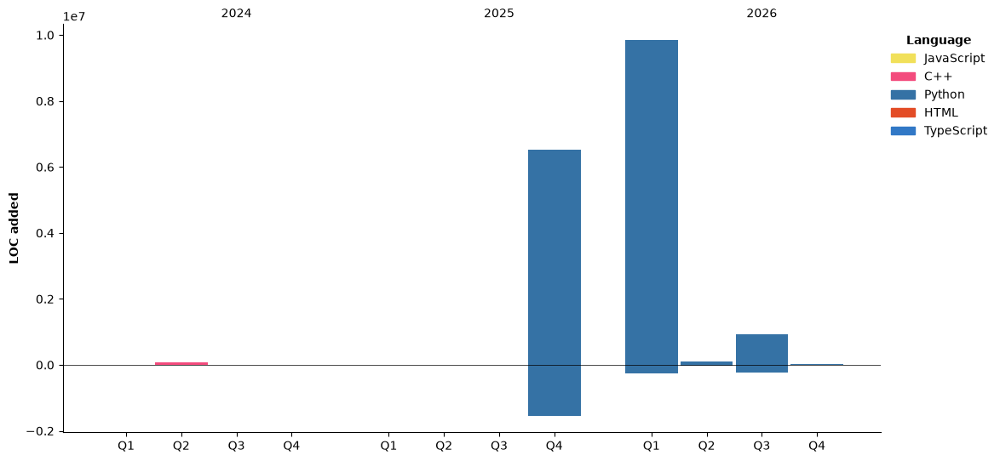

-  Hi, I’m @xiezik
-  I’m interested in robort and ARM.
-  I’m currently learning slam.
I am a junior in Electrical and Computer Engineering from MSU-BIT in Shenzhen, and I am also a RoboMaster team leader.
I have rich experience in embedded development, and now I am also studying salm building and some algorithms, and I have a lot of experience in programming and related algorithms.

<!---
xiezik/xiezik is a ✨ special ✨ repository because its `README.md` (this file) appears on your GitHub profile.
You can click the Preview link to take a look at your changes.
--->


<!--START_SECTION:waka-->


**🐱 My GitHub Data** 

> 📦 1.5 MB Used in GitHub's Storage 
 > 
> 🏆 35 Contributions in the Year 2026
 > 
> 🚫 Not Opted to Hire
 > 
> 📜 24 Public Repositories 
 > 
> 🔑 8 Private Repositories 
 > 
**I'm a Night 🦉** 

```text
🌞 Morning                102 commits         █░░░░░░░░░░░░░░░░░░░░░░░░   02.73 % 
🌆 Daytime                1636 commits        ███████████░░░░░░░░░░░░░░   43.72 % 
🌃 Evening                1631 commits        ███████████░░░░░░░░░░░░░░   43.59 % 
🌙 Night                  373 commits         ██░░░░░░░░░░░░░░░░░░░░░░░   09.97 % 
```
📅 **I'm Most Productive on Monday** 

```text
Monday                   785 commits         █████░░░░░░░░░░░░░░░░░░░░   20.98 % 
Tuesday                  727 commits         █████░░░░░░░░░░░░░░░░░░░░   19.43 % 
Wednesday                548 commits         ████░░░░░░░░░░░░░░░░░░░░░   14.64 % 
Thursday                 364 commits         ██░░░░░░░░░░░░░░░░░░░░░░░   09.73 % 
Friday                   414 commits         ███░░░░░░░░░░░░░░░░░░░░░░   11.06 % 
Saturday                 302 commits         ██░░░░░░░░░░░░░░░░░░░░░░░   08.07 % 
Sunday                   602 commits         ████░░░░░░░░░░░░░░░░░░░░░   16.09 % 
```


📊 **This Week I Spent My Time On** 

```text
💬 Programming Languages: 
No Activity Tracked This Week

🐱‍💻 Projects: 
No Activity Tracked This Week
```

🤖 **AI Coding This Week** 

```text
No AI Coding Activity Tracked This Week
```

**I Mostly Code in Python** 

```text
Python                   16 repos            ███████████████░░░░░░░░░░   61.54 % 
JavaScript               3 repos             ███░░░░░░░░░░░░░░░░░░░░░░   11.54 % 
C++                      3 repos             ███░░░░░░░░░░░░░░░░░░░░░░   11.54 % 
HTML                     1 repo              █░░░░░░░░░░░░░░░░░░░░░░░░   03.85 % 
TypeScript               1 repo              █░░░░░░░░░░░░░░░░░░░░░░░░   03.85 % 
```


**Timeline**




 Last Updated on 01/11/2026 11:09:57 UTC
<!--END_SECTION:waka-->

<!--
**LihanChen2004/LihanChen2004** is a ✨ _special_ ✨ repository because its `README.md` (this file) appears on your GitHub profile.

Here are some ideas to get you started:

- 🔭 I’m currently working on ...
- 🌱 I’m currently learning ...
- 👯 I’m looking to collaborate on ...
- 🤔 I’m looking for help with ...
- 💬 Ask me about ...
- 📫 How to reach me: ...
- 😄 Pronouns: ...
- ⚡ Fun fact: ...
-->
